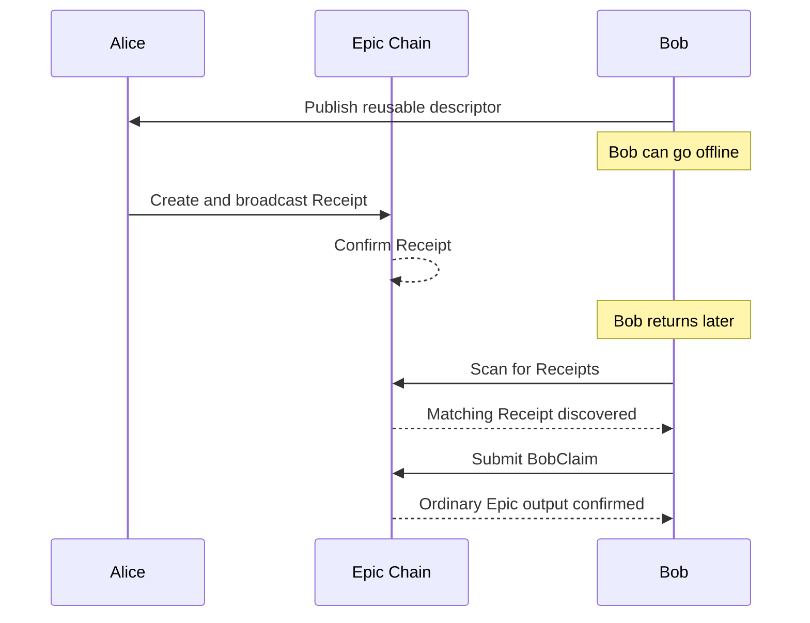
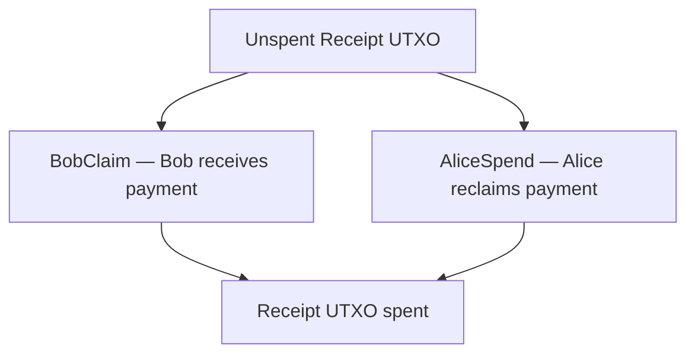

# Epic SNIP

**Semi-Non-Interactive Payments for Epic Cash — Proof of Concept**

Epic SNIP (Semi-Non-Interactive Payments) is an experimental research
implementation that investigates whether Epic Cash can support payments where
the sender creates a transaction while the receiver is offline, without
abandoning Epic's existing Mimblewimble cryptographic foundations.

This is a **research prototype**. It is not intended for production deployment,
has not been cryptographically audited, and is not compatible with Epic
Mainnet or Floonet. All consensus changes are Usernet-only.

## The Problem

Ordinary Mimblewimble transactions are interactive: sender and receiver must
exchange transaction data (blinding factors, range proofs, kernels) before the
transaction can be finalized and broadcast. This requires both parties to be
online or to use an out-of-band communication channel.

The research question Epic SNIP addresses:

> Can Epic Cash support payments where the sender creates a transaction while
> the receiver is offline, without abandoning the existing Mimblewimble
> cryptographic foundations?

## The Approach

Bob publishes a **reusable payment descriptor** once. Alice uses that descriptor
to create payments independently, without Bob being online or involved.

Each payment creates a special **Receipt** output on the chain. Bob can later
scan the chain, discover Receipts addressed to him, and **claim** them into
ordinary Epic outputs. Alice can **reclaim** an unspent Receipt without Bob's
cooperation.

Both parties hold independent authorization keys. The first confirmed valid
spend consumes the Receipt UTXO and prevents the competing spend. Until Bob
successfully claims a Receipt, the payment is not final — Alice can still
reclaim it.

## How It Works



The two alternative spending paths compete for the same UTXO:



Only one path can succeed. The first confirmed valid spend wins.

## Cryptographic Design — High-Level Overview

- **Shared payment blind `q_i`**: both Alice and Bob can derive this from
  Alice's ephemeral secret and Bob's descriptor. It is a balance-construction
  capability, not an authorization.
- **Independent Alice authorization key `a_i`**: derived from Alice's seed.
  Only Alice can produce a valid AliceSpend authorization.
- **Independent Bob authorization key `b_i`**: derived from Bob's descriptor
  secrets. Only Bob can produce a valid BobClaim.
- **Receipt commitment**: a Pedersen commitment hiding the value, with a
  Bulletproof range proof.
- **Authorization verification**: consensus checks that the revealed key hashes
  to the committed value and that the signature verifies.

Knowing the shared blind does not by itself authorize either spending path.
The separation comes from independent authorization keys, not from the blind.

See [PROTOCOL.md](PROTOCOL.md) and
[docs/SNIP_SPEND_AUTHORIZATION_DESIGN.md](docs/SNIP_SPEND_AUTHORIZATION_DESIGN.md)
for implementation details.

## What Was Implemented

- **Cryptographic foundations**: shared receipt keys, Alice authorization,
  Bob receipt key, domain-separated derivation.
- **AliceSpend authorization**: Plain kernel with input-level authorization.
- **BobClaim authorization**: existing ReceiptClaim mechanism, unchanged.
- **Receipt-aware consensus validation**: two-branch resolution, signature
  verification, cut-through exemption.
- **Offline payment creation**: Alice builds funding transactions without Bob.
- **Receipt scanning and discovery**: Bob discovers payments by scanning.
- **Alice reclaim**: Alice reclaims unspent Receipts independently.
- **Bob claim**: Bob claims discovered Receipts into ordinary outputs.
- **Reusable `epic_snip_wallet` library**: deterministic derivation,
  persistence, recovery, single-writer lock.
- **Chain integration**: adapter bridging the wallet to `epic_chain`.
- **Security and architecture review**: threat-model review (Step 3F),
  wallet hardening (Step 3G).

## Proof of Concept Results

The following scenarios were demonstrated and verified:

| Capability | Verification |
|---|---|
| Three independent payments to one descriptor | `phase_a` |
| Bob offline during creation | `phase_a` |
| Bob discovers all three by scanning | `phase_b` |
| Bob claims R1 | `phase_c` |
| Alice reclaims R2 | `phase_c` |
| Bob claims R3 after wallet restart | `phase_c` |
| Double-spend rejected | `phase_d`, `double_spend_rejection` |
| Bob-claim-wins order | `phase_e1` |
| Alice-reclaim-wins order | `phase_e2` |
| Seed recovery (Bob, Alice) | `snip_wallet_recovery` (15 tests) |
| Key separation and domain separation | wallet unit tests (10 tests) |

All transactions were validated through the actual Epic chain implementation,
not merely simulated. See [POC_RESULTS.md](POC_RESULTS.md) for the full
test-to-capability mapping.

## Running the Proof of Concept

From the `upstream/epic` directory:

```sh
# Wallet unit tests (derivation, persistence, locking)
cargo test -p epic_snip_wallet

# Chain-level recovery and hardening tests
cargo test -p epic_chain --test snip_wallet_recovery -- --test-threads=1

# Step 3D demonstration (3 payments, claims, conflicts, restart)
cargo test -p epic_chain --test snip_wallet -- --test-threads=1

# Core cryptographic and consensus tests
cargo test -p epic_core --lib

# Spend attribution and authorization tests
cargo test -p epic_chain --test spend_attribution -- --test-threads=1

# Receipt claim roundtrip
cargo test -p epic_chain --test receipt_claim_roundtrip -- --test-threads=1
```

## Limitations

- **Research prototype**: not for production deployment.
- Epic Cash does not support this mechanism without the implemented extensions.
- No production network activation is intended.
- Alice can reclaim an unspent Receipt at any time.
- Receipt discovery is not equivalent to final payment settlement.
- Alice seed-only recovery requires re-importing the public descriptor.
- The security review is not a formal cryptographic proof.
- The prototype does not claim production readiness.
- Activation is gated by test flags, not height-based consensus rules.

## Project Conclusion

**Epic SNIP demonstrates that semi-non-interactive payments can be implemented
using targeted extensions to Epic Cash's existing Mimblewimble cryptographic and
consensus architecture.**

The objective was technical feasibility, not production deployment.

## Further Documentation

- [PROTOCOL.md](PROTOCOL.md) — functional specification
- [POC_RESULTS.md](POC_RESULTS.md) — PoC validation results
- [CURRENT_STEP.md](CURRENT_STEP.md) — implementation history (Steps 3A–3H)
- [docs/SNIP_SPEND_AUTHORIZATION_DESIGN.md](docs/SNIP_SPEND_AUTHORIZATION_DESIGN.md) — design and threat model
- [docs/SNIP_SPEND_ATTRIBUTION_RESEARCH.md](docs/SNIP_SPEND_ATTRIBUTION_RESEARCH.md) — attribution research

---

# Epic SNIP — Einseitige Wiederverwendbare Zahlungen

> **Experimenteller Forschungsstand — nicht für reale Gelder.** Der lokale
> `upstream/epic`-Fork enthält einen Usernet-only Konsensentwurf und ist weder
> mit Epic Mainnet/Floonet kompatibel noch kryptografisch auditiert. Er darf
> nicht an EpicCash-Upstreams gepusht und nicht als produktionsreif verstanden
> werden.

## Oberste Priorität

Dieses Projekt verfolgt **eine** Sache: die vollständige Demonstration des
in [PROTOCOL.md](PROTOCOL.md) definierten Transaktionsflusses.

Bob veröffentlicht einen **Payment Descriptor** einmalig.
Alice erstellt daraus **drei unabhängige Zahlungen**
(ohne Bob, ohne Kommunikation) und bringt sie in der
lokalen **Usernet-Chain** zur Bestätigung.
Bob **detektiert** alle drei **durch Scannen der Chain**,
bestimmt **dass** und **den Betrag**, und **claimt** jede
in einer **eigenen Transaktion** auf einen
**ausschließlich von ihm auszahlbaren** Output.
Alle drei Claims werden in der Usernet-Chain bestätigt.

**Zusätzliche Anforderungen (PROTOCOL.md §3.8, §3.9):**
- **Alice kann aus der Chain verifizieren**, dass Bob die
  Zahlungen übernommen hat.
- **Alice kann die Shared Outputs jederzeit selbst
  beanspruchen**, solange Bob sie nicht bereits in seine
  eigenen Outputs übertragen hat. Der erste bestätigte
  gültige Spend gewinnt (First-Confirmed-Spend-Wins).

Jede andere Arbeit in diesem Repo — die In-Memory-POC unter
`src/one_sided.rs`, der Receipt-Claim-Forschungspfad unter
`upstream/epic`, die Attributionsforschung — ist
**abgeschlossen und überholt durch diese Spezifikation**.
Sie bleibt als historische Aufzeichnung erhalten.

## Ausführen

```sh
cargo fmt --check
cargo test
```

### Ziel-Test (in Arbeit)

Der zu schreibende Akzeptanz-Integrationstest muss den
vollständigen 3-Zahlungs-Flow demonstrieren:

```sh
# (noch nicht vorhanden — folgt aus PROTOCOL.md §5)
cargo test -p epic_chain --test snip_acceptance
```

### Bestehende, abgeschlossene Tests (historisch)

```sh
cd upstream/epic
cargo test -p epic_core --lib
cargo test -p epic_chain --test receipt_claim_roundtrip
cargo test -p epic_chain --test spend_attribution
cargo run -p epic_core --example receipt_stealth_demo
```

Diese Tests dienen der Recherche und der Überprüfung einzelner
Bausteine. Gemäß PROTOCOL.md §6 **ersetzen sie nicht** die
vollständige 3-Zahlungs-Demonstration.

## Sicherheitsgrenzen

Keine Mainnet-Kompatibilität. Keine echten Gelder. Keine
Netzwerke. Alle Schlüssel sind ephemere Testmaterialien.
Die lokale Range-Proof-, Kernel-Signatur- und
TxHashset-Validierung belegen ausschließlich den
beschriebenen Usernet-Forschungsumfang.

## Dokumentation

- **Oberste Priorität und Funktionalspezifikation:** [PROTOCOL.md](PROTOCOL.md)
- **Fortlaufender Status:** [CURRENT_STEP.md](CURRENT_STEP.md)
- Historisch: [One-sided-POC](docs/one-sided-poc.md), [Receipt-Claim-Entwurf](docs/receipt-claim-design.md), [Kryptografische Grundlage](docs/cryptographic-foundation.md), [Protokollspezifikation (POC)](docs/protocol-spec.md), [Bedrohungsmodell](docs/threat-model.md), [Annahmen](docs/assumptions-and-open-questions.md), [Testplan (POC)](docs/test-plan.md), [Übergabe zur Weiterarbeit](docs/continuation-guide.md), [Usernet-Experiment](docs/usernet-experiment.md), [Spend-Attribution-Forschung](docs/SNIP_SPEND_ATTRIBUTION_RESEARCH.md)

Alle Dokumentations-Links auf die historischen Pfade
gilt: sie beschreiben den **abgeschlossenen**
Forschungsstand, **nicht** den in PROTOCOL.md
definierten Zielzustand.