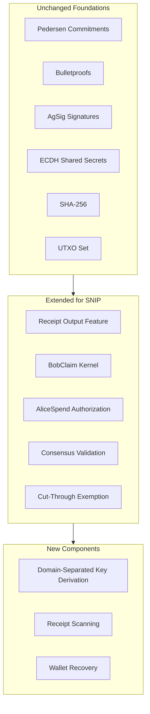

# Epic Protocol Changes for SNIP

## Overview

This document assesses the changes required to implement Epic SNIP
(Semi-Non-Interactive Payments) on top of the original Epic Cash
Mimblewimble architecture. It is a developer-oriented comparison of
what was reused, what was extended, and what was added.

Epic SNIP was implemented as a **Usernet-only research prototype**.
No Mainnet or Floonet activation is intended.

## Comparison Table

| Area | Original Epic Cash | Epic SNIP | Impact |
|---|---|---|---|
| **Pedersen commitments** | Used for all outputs; `commit(value, blind)` | Reused unchanged. Receipt output is a standard Pedersen commitment `q_i * G + v * H`. | **Low** |
| **Bulletproofs** | Range proofs on every output | Reused unchanged. Receipt output carries a standard Bulletproof rewound with `q_i`. | **Low** |
| **Transaction construction** | Standard `Plain`, `Coinbase`, `HeightLocked` kernels | Added `BobClaim` kernel (U8 = 3) with `ReceiptClaim` transcript. Alice path uses ordinary `Plain` kernel. | **Medium** |
| **Receipt outputs** | No receipt concept; all outputs are `Plain`/`Coinbase` | New `OutputFeatures::Receipt` with `SharedReceiptKeyHashes` (bob + alice hashes) and `ReceiptStealthHint` (33-byte ephemeral pubkey). | **High** |
| **Kernel authorization** | Kernel excess signature only | Added `ReceiptClaim` (Bob: signature by `b_i`) and `ReceiptSpendAuthorization` (Alice: signature by `a_i` bound to kernel hash). | **High** |
| **Consensus validation** | `verify_receipt_resolution` requires 1:1 `Receipt` input ↔ `BobClaim` kernel | Extended to two-branch: BobClaim (with claim) OR AliceSpend (Plain + authorization). Mixed branch rejected. | **High** |
| **Cut-through** | Removes any input whose hash equals an output hash | Receipt inputs/outputs explicitly exempt. Evidence must never be cut. | **Medium** |
| **UTXO handling** | Standard UTXO set (OutputIdentifier) | `OutputIdentifier::from_input` ignores authorization. UTXO lookup unchanged. Already-spent Receipts rejected by UTXO set. | **Low** |
| **Wallet key derivation** | Standard HD key paths (BIP32-style) | Added domain-separated hardened paths: `m / SNIP_PURPOSE' / ROLE' / INDEX' / KEY_TYPE'`. | **Medium** |
| **Scanning** | Standard output scanning by key path | New Receipt scanning: derive Bob's one-time keys from descriptor + hint, check `hashes.bob`, rewind amount. Alice scans by `H(A_i)`. | **Medium** |

## Unchanged Cryptographic Foundations

The following Epic Cash cryptographic primitives were **reused without
modification**:

- **Pedersen commitments**: `commit(value, blind)` on secp256k1. No
  change to the commitment scheme, the blinding algebra, or the
  homomorphic properties.
- **Bulletproofs**: range proofs are standard. The Receipt output's
  proof is rewound with `q_i` so Bob can recover the value; the proof
  format and verification are unchanged.
- **Aggregated signatures (AgSig)**: the same `sign_single` / `verify`
  primitives are used for kernel excess signatures and authorization
  signatures.
- **ECDH shared secrets**: `SharedSecret::new` on secp256k1 is reused
  for deriving the stealth tweak and the shared blind.
- **SHA-256**: used for domain-separated hashing in key derivation and
  authorization messages. No change.
- **secp256k1 scalar arithmetic**: `SecretKey`, `PublicKey`,
  `add_assign`, `from_slice` validation — all reused.

**Conclusion:** SNIP does not introduce new cryptographic primitives.
It composes existing Epic Cash primitives (Pedersen, Bulletproofs,
AgSig, ECDH, SHA-256) in a new way.

## Extended Consensus Rules

### Receipt Feature

A new output feature `OutputFeatures::Receipt` was added. Receipt
outputs carry:

- `receipt_key_hashes`: `SharedReceiptKeyHashes { bob: [u8;32], alice: [u8;32] }`
- `receipt_stealth_hint`: 33-byte ephemeral public key (canonically serialized)

The `OutputIdentifier` (UTXO identity) includes these fields, so a
Receipt output is distinct from an ordinary output with the same
commitment.

### Two-Branch Resolution

`verify_receipt_resolution` was extended from a count rule
(`receipt_inputs.len() == receipt_kernels.len()`) to a two-branch
per-input rule:

- **Bob path**: `receipt_spend_authorization` is `None`, exactly one
  `BobClaim` kernel matches by `original_commitment`, and
  `hashes.matches_bob(claim.receipt_public_key)`.
- **Alice path**: `receipt_spend_authorization` is `Some(auth)`,
  `auth.path == AliceSpend`, `auth.original_commitment == input.commit`,
  `hashes.matches_alice(auth.alice_public_key)`, and exactly one
  `Plain` kernel matches by excess/fee/kernel hash.

Mixed branch (both auth and BobClaim on the same input) is rejected.
A kernel may not resolve two different receipt inputs.

### Authorization Verification

A new full-validation pass `verify_receipt_spend_authorizations` verifies
the Alice signature against the authorization message, which binds:
version, chain id, path tag, original commitment, kernel excess, fee,
kernel hash, and Alice's public key.

### Cut-Through Exemption

Receipt inputs and outputs are excluded from `cut_through` and
`verify_cut_through`. This prevents removal of resolution evidence
when a receipt input and output appear in the same block.

### Activation

Receipt features are rejected unless `is_user_testing_mode()` or
`is_automated_testing_mode()` is set. Production requires a
height-based activation (deferred).

## What Was NOT Changed

- **Pedersen commitment scheme**: no change.
- **Bulletproof format/verification**: no change.
- **AgSig scheme**: no change.
- **Output MMR / kernel MMR**: no change.
- **Block structure**: no change.
- **UTXO set semantics**: no change (Receipt is just a new output feature).
- **Ordinary Epic transactions**: completely unaffected. A transaction
  without Receipt features follows the exact same validation path.
- **Mainnet/Floonet activation**: not modified. All changes are
  Usernet-only.

## Architecture Overview

## Summary

SNIP adds a **new output feature** (`Receipt`) and **two authorization
paths** (BobClaim, AliceSpend) on top of existing Epic Cash primitives.
The cryptographic foundations (Pedersen, Bulletproofs, AgSig, ECDH,
SHA-256) are entirely reused. The consensus changes are scoped to
receipt-feature transactions only; ordinary transactions are unaffected.

The primary impact is **High** in the areas of Receipt outputs, kernel
authorization, and consensus validation, because these introduce new
data structures and validation rules. The impact is **Low** in
Pedersen commitments, Bulletproofs, and UTXO handling, because these
are reused as-is.