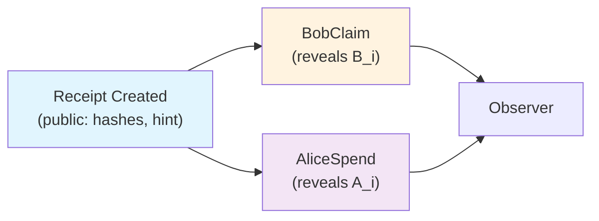

# SNIP Privacy Attack Vectors

## Overview

This document performs a focused privacy and linkability assessment of the
implemented Epic SNIP protocol. It analyzes potential information leakage
at the protocol, wallet, and network layers.

Epic SNIP is a research prototype. This assessment is not a formal
privacy proof. Verification statuses: **Demonstrated**, **Plausible**,
or **Not Yet Tested**.

## Attack Vectors

### 1. Receipt Fingerprinting

**Description:** Receipt outputs carry `OutputFeatures::Receipt`, which is
consensus-visible. Any observer can distinguish a Receipt output from an
ordinary Epic output by inspecting the output features.

**Attacker capabilities:** Passive chain observer.

**Information exposed:** The fact that a transaction creates or spends a
Receipt output. The number and positions of Receipt outputs in a block.

**Severity:** Low. **Exploitability:** Trivial (public data).

**Existing protections:** None at the protocol level. The Receipt feature
is required for the two-branch enforcement.

**Mitigations:** None without changing the output format. The feature
flag is the minimum needed for consensus to apply Receipt rules.

**Verification status:** Demonstrated (by design).

---

### 2. Linkability: Receipt Creation → BobClaim

**Description:** When Bob claims a Receipt, the `BobClaim` kernel reveals
`receipt_public_key = B_i`, which hashes to `hashes.bob` in the Receipt
output. An observer can link the claim to the original Receipt output by
matching `original_commitment` and the key hash.

**Attacker capabilities:** Passive chain observer with knowledge of the
Receipt output.

**Information exposed:** The link between a Receipt output and its claim
transaction. The claim reveals `B_i` (a one-time key), but not Bob's
long-term identity.

**Severity:** Low. **Exploitability:** Trivial (public data).

**Existing protections:** `B_i` is fresh per payment (derived from Bob's
descriptor and the per-payment hint). Cross-payment linkage is
prevented by fresh `b_i`.

**Mitigations:** None needed; fresh keys per payment limit linkability.

**Verification status:** Demonstrated (by design, documented in design doc §9).

---

### 3. Linkability: Receipt Creation → AliceSpend

**Description:** When Alice reclaims a Receipt, the `Plain` kernel reveals
`A_i` (Alice's authorization public key) via the authorization. An
observer can link the spend to the Receipt output by matching
`original_commitment` and `hashes.alice`.

**Attacker capabilities:** Passive chain observer.

**Information exposed:** The link between a Receipt output and Alice's
reclaim. Reveals `A_i` (one-time), but not Alice's identity.

**Severity:** Low. **Exploitability:** Trivial.

**Existing protections:** `A_i` is fresh per payment (deterministic from
Alice's seed + index, but unique per index). Cross-payment linkage
prevented by fresh `a_i`.

**Mitigations:** None needed.

**Verification status:** Demonstrated (by design).

---

### 4. Public Authorization Keys and Committed Hashes

**Description:** The Receipt output commits to `H(B_i)` and `H(A_i)`.
When spent, the corresponding public key is revealed. An observer can
verify that the revealed key matches the committed hash.

**Attacker capabilities:** Passive observer.

**Information exposed:** One-time public keys `B_i` and `A_i` are revealed
at spend time. The hashes are visible from creation.

**Severity:** Low. **Exploitability:** Trivial.

**Existing protections:** Keys are one-time; no long-term identity
leaked. Fresh `b_i`/`a_i` per payment prevents cross-payment linkage.

**Mitigations:** None needed for the PoC. Key reuse by the wallet would
be a privacy failure (documented as caller responsibility).

**Verification status:** Demonstrated.

---

### 5. Stealth Metadata and Descriptor Reuse

**Description:** The Receipt output carries a `ReceiptStealthHint` (33-byte
ephemeral public key) and `receipt_key_hashes`. If Bob reuses his
descriptor for many payments, all Receipt outputs reference the same
descriptor's public keys (via `H(B_i)` where `B_i = P + h_i * G`).
An observer could attempt to link payments to the same descriptor by
checking if the derived `B_i` values share a common structure.

**Attacker capabilities:** Passive observer with knowledge of Bob's
descriptor.

**Information exposed:** If the descriptor is public, an observer can
verify that a Receipt output's `hashes.bob` corresponds to a key
derived from that descriptor. This reveals that the payment is to Bob.

**Severity:** Medium. **Exploitability:** Requires knowledge of Bob's
descriptor (public by design).

**Existing protections:** `B_i` is a one-time key per payment (fresh
tweak from the ephemeral hint). The descriptor itself is public by
design — Bob publishes it to enable payments.

**Mitigations:** Descriptor authenticity must be handled by the
distribution mechanism (out of scope). Descriptor rotation is possible
but not implemented.

**Verification status:** Plausible (design property, not demonstrated as
exploitable).

---

### 6. Blockchain Scanning and Recipient Identification

**Description:** Bob scans the chain by checking every Receipt output
against his descriptor. An observer watching Bob's scan behavior
(e.g., which blocks he requests) could infer his interest in certain
outputs. Additionally, the scan requires Bob to derive keys for every
Receipt output, which is computationally observable if Bob runs a node.

**Attacker capabilities:** Network observer or node operator.

**Information exposed:** Bob's scan pattern (which blocks/outputs he
examines). If Bob runs a light client, the server sees his queries.

**Severity:** Low (network-level). **Exploitability:** Requires network
observation.

**Existing protections:** None at the protocol level. Bob can scan
locally if running a full node.

**Mitigations:** Run a full node locally. Use Tor or similar for
network privacy (out of scope).

**Verification status:** Not Yet Tested.

---

### 7. Timing, Amount Correlation, and Transaction Graph Analysis

**Description:** Receipt creation, claim, and reclaim transactions appear
on the chain at specific times. An observer could correlate:
- The timing of a funding transaction with a subsequent claim.
- Amount patterns (if amounts are not sufficiently varied).
- Transaction graph structure (input → Receipt → claim output).

**Attacker capabilities:** Passive chain observer with temporal and
graph analysis tools.

**Information exposed:** Temporal correlation between funding and claim.
Amount correlation if amounts are distinctive. Graph structure reveals
the payment flow.

**Severity:** Medium. **Exploitability:** Depends on usage patterns.

**Existing protections:** Amounts are hidden by Pedersen commitments
and Bulletproofs. The value is not visible to observers.

**Mitigations:** Use varied amounts and timing. Avoid creating and
claiming in the same block. Use transaction aggregation.

**Verification status:** Plausible (standard blockchain analysis
technique, not demonstrated on SNIP specifically).

---

### 8. Cut-Through Exemptions and Long-Term Footprint

**Description:** Receipt inputs and outputs are exempt from cut-through.
This means Receipt resolution evidence (BobClaim kernel, Alice
authorization) is permanently preserved in the blockchain. An observer
can always verify that a Receipt was claimed and by which path.

**Attacker capabilities:** Passive chain observer (any time).

**Information exposed:** The fact that a Receipt was spent, and which
path (BobClaim or AliceSpend) was used. The timing of the spend.

**Severity:** Low. **Exploitability:** Trivial (public data).

**Existing protections:** The amount remains hidden. Only the path type
and timing are revealed.

**Mitigations:** This is by design — evidence preservation is a
consensus requirement. No mitigation without changing the consensus
rules.

**Verification status:** Demonstrated (by design, documented in design
doc §6.8).

---

### 9. Transaction Aggregation and Privacy Implications

**Description:** SNIP transactions can be aggregated with other
transactions. When aggregated, the Receipt input/output pair is
preserved (exempt from cut-through), but the aggregation may obscure
which kernel belongs to which input.

**Attacker capabilities:** Passive observer of aggregated blocks.

**Information exposed:** If aggregation mixes multiple Receipt
transactions, an observer may not be able to determine which claim
corresponds to which funding transaction, improving privacy.

**Severity:** Low. **Exploitability:** Depends on aggregation usage.

**Existing protections:** Aggregation is supported by the design.
Receipt inputs/outputs are preserved.

**Mitigations:** Encourage aggregation in wallet implementations.

**Verification status:** Not Yet Tested (aggregation with Receipt
transactions not specifically tested).

---

### 10. Network-Layer Observation and Transaction Broadcasting

**Description:** When Alice broadcasts a funding transaction or Bob
broadcasts a claim, network observers (peers, miners) can see the
transaction before it is confirmed. They can observe:
- The sender's IP address (if not using Tor).
- The transaction timing and structure.
- The Receipt features (visible in the transaction).

**Attacker capabilities:** Network observer or miner.

**Information exposed:** IP address, transaction timing, transaction
structure.

**Severity:** Medium. **Exploitability:** Requires network observation.

**Existing protections:** None at the protocol level.

**Mitigations:** Use Tor or similar (out of scope). Broadcast via
relays. Delay broadcasting.

**Verification status:** Not Yet Tested.

---

### 11. Wallet Recovery Metadata and Information Leakage

**Description:** The wallet store persists payment records (payment ID,
receipt commitment, amount, confirmation height, status) as JSON.
If the store file is accessible to an attacker, they can learn:
- Which payments were made/received.
- Amounts.
- Confirmation heights and spend status.
- Descriptor public keys.

**Attacker capabilities:** Local file system access (malware, stolen
device).

**Information exposed:** Full payment history, amounts, status.

**Severity:** High (if device compromised). **Exploitability:** Requires
local access.

**Existing protections:** No private keys stored (secrets re-derived
from seed). Store is not encrypted.

**Mitigations:** Encrypt the store at rest. Use OS-level file
protection. Do not store on shared/untrusted devices.

**Verification status:** Demonstrated (store content is plaintext JSON
with public metadata; no secrets, but amounts and history are visible).

---

## Information Flow

An observer can link a spend to its Receipt by matching
`original_commitment` and the key hash. The one-time keys
`B_i` / `A_i` are revealed, but long-term identities are not.

## Summary Table

| # | Attack Vector | Severity | Exploitability | Verification Status |
|---|---|---|---|---|
| 1 | Receipt fingerprinting | Low | Trivial | Demonstrated |
| 2 | Creation → BobClaim linkability | Low | Trivial | Demonstrated |
| 3 | Creation → AliceSpend linkability | Low | Trivial | Demonstrated |
| 4 | Public authorization keys/hashes | Low | Trivial | Demonstrated |
| 5 | Stealth metadata and descriptor reuse | Medium | Plausible | Plausible |
| 6 | Blockchain scanning observation | Low | Requires network obs. | Not Yet Tested |
| 7 | Timing/amount/graph analysis | Medium | Usage-dependent | Plausible |
| 8 | Cut-through exemption footprint | Low | Trivial | Demonstrated |
| 9 | Transaction aggregation | Low | Usage-dependent | Not Yet Tested |
| 10 | Network-layer observation | Medium | Requires network obs. | Not Yet Tested |
| 11 | Wallet recovery metadata leakage | High (local) | Requires local access | Demonstrated |

## Conclusion

The SNIP protocol's core privacy properties are sound: amounts are
hidden by Pedersen commitments, long-term identities are not revealed,
and one-time keys prevent cross-payment linkage. The main privacy
risks are at the **wallet and network layers** (plaintext store,
network observation) and through **usage patterns** (timing, amounts,
descriptor reuse). These are standard blockchain privacy concerns, not
SNIP-specific vulnerabilities.

Protocol-level privacy (amount hiding, identity separation) is
maintained. Network-level and wallet-level privacy require additional
measures outside the scope of this PoC.